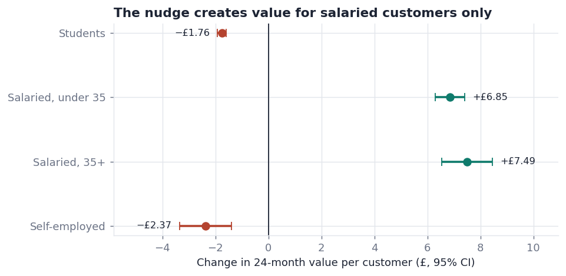
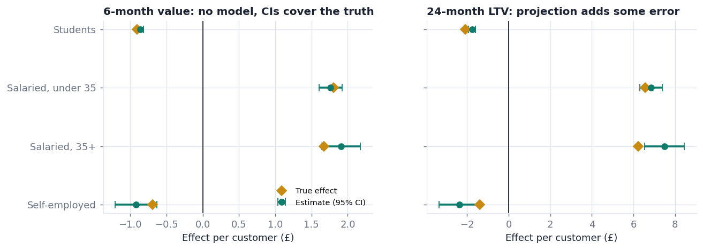

# Does it pay? Experiment and lifetime-value analysis of a savings nudge

A product data science project on a simulated UK digital bank. I ran a 1,000,000-customer A/B test of an in-app savings nudge and found that the primary metric improved strongly. Lifetime-value modelling then showed the nudge only creates value for salaried customers, which changed the launch decision.

**Recommendation: launch to salaried customers (63% of eligible customers) and hold for students and the self-employed.** A targeted launch is worth an estimated £448k in 24-month value per 100,000 eligible customers, against £373k for launching to everyone.

[Decision memo](docs/decision_memo.md) · [Dashboard](dashboard/index.html) · [Pre-registration](docs/pre_registration.md)



## The question

Customers who pay their salary into their account are worth far more to a bank. The product team built a nudge encouraging recent customers to open a savings pot and move their salary in. The test question was simple: does it increase salary deposits? The question that matters is harder: **does it make customers more valuable, and for whom?**

## Key results

| | Result |
|---|---|
| Primary metric: salary moved in within 30 days | 9.6% → 15.2% (+5.7pp, 95% CI 5.6 to 5.8) |
| Guardrails (support contacts, account closures) | Both passed |
| 24-month value, salaried under 35 | +£6.85 per customer |
| 24-month value, salaried 35+ | +£7.49 per customer |
| 24-month value, students | −£1.76 per customer |
| 24-month value, self-employed | −£2.37 per customer |

**Why value falls for some segments.** Students and self-employed customers respond by moving money from their current account into lower-margin savings and spending slightly less on card. They engage with the feature, but bring in no new money.

## What the analysis covers

- **Experiment design.** Pre-registered hypotheses, metrics, guardrails and decision rules. The power analysis shows the sample must be sized for segment-level LTV (~930k customers), not the primary metric (~30k).
- **Sample ratio mismatch.** Exposure logs showed a 48.6% treatment share (p < 10⁻¹⁰⁰). I traced it to a logging bug on legacy Android, then switched to intention-to-treat on server-side assignments. The naive estimate would have been inflated.
- **CUPED variance reduction.** Pre-period covariates cut variance by 61% on card spend and by 4% on the binary primary metric.
- **Heterogeneous effects.** Segment analysis uses Holm correction for multiple testing.
- **Novelty effect.** The week-1 lift in pot usage (+480%) settles to about +150% by week 5.
- **Cohort LTV model.** 6 months observed plus a projection to 24 months, using retention, late salary switching (with value uplift estimated within customer to avoid selection bias) and discounting.
- **Method validation.** The data is simulated with known true effects, so I graded my own methods:
  - Intention-to-treat and 6-month value estimates recover the truth.
  - The 24-month projection gets every launch decision right, but overstates the £ value by about 11%. Its intervals ignore model error, which I flag in the memo.



## Tech stack

- **Python** (pandas, NumPy, SciPy, matplotlib) for simulation, statistics, LTV and charts. All statistical methods are written out explicitly in `src/analysis_utils.py`.
- **SQL with dbt** for staging and mart models, data tests and finance assumptions as dbt vars.
- **Warehouses.** The project runs locally on SQLite with zero setup, and the same models run on BigQuery ([guide](docs/bigquery_setup.md)).
- **Dashboard.** A self-contained HTML readout, plus a [Looker Studio spec](docs/looker_studio_spec.md).

## Run it

```bash
pip install -r requirements.txt
python src/run_all.py      # about 3 minutes: simulate → build warehouse → test → analyse → report
```

Open `dashboard/index.html` in a browser.

## Project structure

```
src/
  config.py                    all assumptions in one place
  01_simulate_data.py          1M customers, planted effects, ground truth
  02_build_warehouse.py        load raw data, run dbt models, run data tests
  03_power_analysis.py         sample size and power curves
  04_experiment_analysis.py    SRM, ITT, CUPED, guardrails, segments, novelty
  05_ltv_model.py              cohort LTV and business case
  06_validate_against_truth.py grade the methods against the true effects
  07_build_reports.py          decision memo and dashboard
  analysis_utils.py            statistics helpers
dbt/
  models/staging/              stg_* views
  models/marts/                fct_experiment_users, fct_user_monthly_value, agg_weekly_pot_transfers
  tests/                       singular data tests
docs/                          pre-registration, decision memo, setup guides
outputs/                       figures, tables, results (JSON)
dashboard/index.html           experiment readout
```

## Honest limitations

- **The data is simulated.** Effects and unit economics are assumptions, chosen to be plausible for a UK digital bank, and are not any real bank's figures.
- **The projection is overconfident.** The 24-month value projection's confidence intervals reflect sampling error only. A long-running holdout would be needed to calibrate it in practice.
- **Segments are coarse.** An uplift model could target individual customers rather than whole segments.
